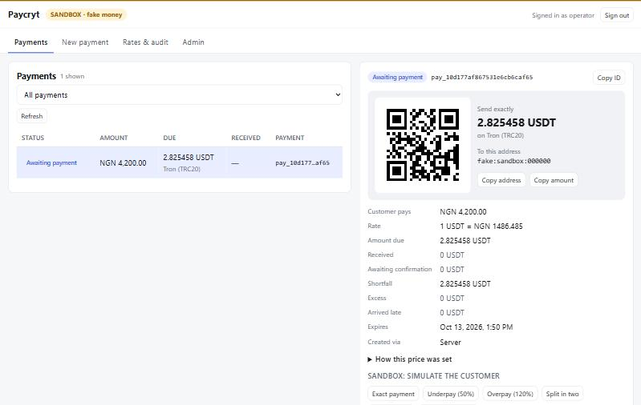

# Web dashboard

The server ships with a small web app, so you can use Paycryt without writing a line of code or typing `curl`.



```bash
npm run build && npm run sandbox
# open http://127.0.0.1:8787/ and sign in with the key  sandbox_key
```

It is plain HTML, CSS and JavaScript served by the server itself: no framework, no build step, no third-party scripts, nothing to deploy separately.

A merchant who signs in gets an **Open POS** link to the [offline POS app](pos.md).

## What you can do

| | Operator (admin key) | Merchant (their own key) |
|---|---|---|
| See payments, status, amounts, history | all merchants | their own only |
| Download reconciliation CSV | all merchants | their own only |
| Create a payment, with a QR code of the deposit address and the exact amount | yes | yes |
| Copy the address or the exact amount, see what is still owed on a part-payment | yes | yes |
| Look up a rate, see exactly which sources set it, and verify the audit chain | yes | yes |
| Simulate the customer (exact, short, over, split, late, unconfirmed) | sandbox | sandbox |
| Move the fake clock, mine blocks | sandbox | no |
| Server health, chain-lookup failures, poll status | yes | no |
| Add merchants, rotate keys, disable/enable | yes | no |
| Read the admin audit log | yes | no |

A `SANDBOX` or `LIVE` badge is always on screen, with a coloured top border, so nobody mistakes fake money for real.

The page works on a phone. It lists the newest 200 payments and refreshes every 4 seconds while a tab is visible.

## Reconciliation CSV

Choose **Download CSV** on the Payments tab to save `paycryt-payments.csv`. It includes **all payments your key can read**, regardless of the screen's status filter or 200-row display limit. A merchant gets only their own payments; the admin gets all payments. The download uses the same in-memory API key and request limits as the payment list, without putting the key in a URL or browser storage.

The API is `GET /v1/payments.csv`, with the usual `Authorization: Bearer …` header. Optional `from` and `to` bounds filter the payment's **creation time**: `from` is inclusive and `to` is exclusive. Both accept a UTC date (`YYYY-MM-DD`, midnight UTC) or a UTC timestamp (`YYYY-MM-DDTHH:mm:ssZ`, optionally with one to three fractional-second digits). For example, `/v1/payments.csv?from=2026-10-01&to=2026-11-01` exports payments created during October in UTC. Invalid or impossible dates, repeated bounds and `from >= to` return a JSON error with status `400`. Omitting both bounds exports the complete accessible list.

The fixed columns are:

| Column | Value |
|---|---|
| `id`, `created`, `status` | Payment ID, creation time as an ISO UTC timestamp, and current payment status |
| `fiat_currency`, `fiat_amount` | Currency code and exact decimal amount in major fiat units |
| `asset`, `chain`, `amount_due`, `received` | Asset symbol, chain, exact decimal amount due and currently confirmed received amount in asset units |
| `address`, `rate_snapshot_hash`, `note` | Deposit address, the pricing snapshot's hash, and `metadata.note` (empty when absent) |

Amounts are formatted directly from `bigint` minor units using the currency or asset's decimals; no floating-point conversion or rounding is introduced. Trailing fractional zeros are trimmed. Spreadsheet programs may still round long numbers when automatically importing them, so import the amount columns as **text** when exact digits matter.

The file is UTF-8, with a header, quoted cells and CRLF record endings. Embedded quotes are doubled; commas, Unicode and embedded line breaks remain inside their cell. Potential formulas in text fields are prefixed with an apostrophe, including `=`, `+`, `-` or `@` after leading whitespace/control characters and fields starting with a tab or line break. Preserve that prefix when opening the file in a spreadsheet. A range with no matching payments returns just the header. Responses use `Cache-Control: no-store`; the downloaded file itself contains payment history and should be kept with the same care as a database export.

## How it handles your API key

The page holds an API key, so it is built defensively:

- **The key lives in page memory only.** It is not written to `localStorage`, `sessionStorage` or a cookie. Reload the page and you sign in again.
- **Strict Content-Security-Policy.** Only same-origin scripts and styles, no inline script or style, nothing loaded from another origin, no framing, no form posts, no referrer. A test pins this.
- **No HTML injection.** Every value from the API is inserted as text, never as markup (`innerHTML` is banned by a test that scans the source), so a hostile payment `metadata` value cannot run code in the operator's browser.
- **A fixed list of files.** The server serves exactly five files from `packages/server/ui/`. A request path is never turned into a filesystem path.
- **The page itself carries no data.** It is served without authentication, so a visitor can load the login screen, but every number on it comes from the authenticated API. Static files do not use up a key's request budget.

Over the public internet, put the server behind HTTPS (a reverse proxy such as Caddy or nginx). The key travels in an `Authorization` header on every request.

## Turning it off

An API-only deployment can expose less:

```bash
PAYCRYT_DISABLE_UI=true node packages/server/dist/cli.js
```

or `PaycrytServer.create({ ..., ui: false })`. Then `/` goes back to answering `401` for a missing key.

## Good to know

- **The QR code encodes the deposit address, not a payment URI.** Wallets disagree about amount-bearing URIs (EIP-681, BIP-21, TRON have no common standard), and a bare address is accepted by all of them. The exact amount sits next to it, with a copy button.
- **The QR encoder is in-house** (`ui/qr.js`, about 300 lines, versions 1–6, up to ~130 bytes), so the page ships no third-party code. It was compared module-for-module against an independent library for every mask and error-correction level (264 symbols, zero differences), and a symbol rendered by the real page was decoded back to the exact address with a separate scanner.
- **No pagination yet.** The payment list is fetched whole and the newest 200 are shown.
- **Files are read once at startup.** If you edit `ui/*` while developing, restart the server.

## Developing it

Everything is in `packages/server/ui/`: `index.html`, `style.css`, `app.js` (the app), `qr.js` (QR encoder), `util.js` (formatting helpers). There is no bundler. The helpers and the encoder are unit-tested directly (`packages/server/test/qr.test.ts`); serving and the safety rules are tested in `dashboard.test.ts`.
