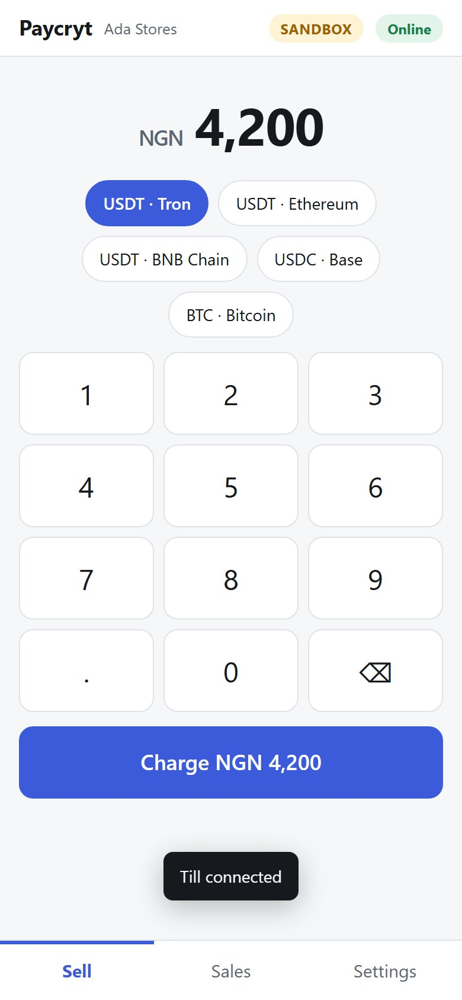
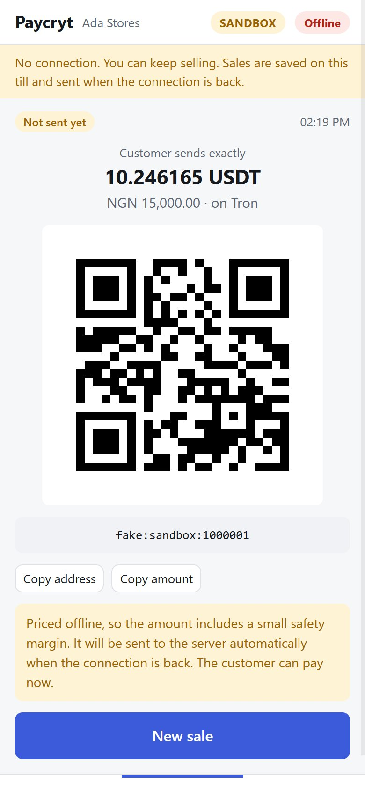
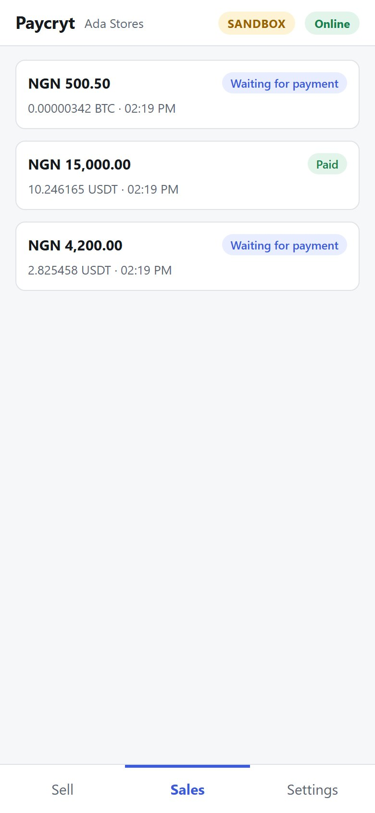

# The offline POS app

A till that keeps selling when the internet does not work. It is a web app that installs to a phone or tablet home screen, served by your own Paycryt server.

<p align="center">
  
  
  
</p>

```bash
npm install && npm run build && npm run sandbox
# 1. open http://127.0.0.1:8787/ , sign in with sandbox_key, add a merchant, copy the key it shows once
# 2. open http://127.0.0.1:8787/pos on a phone (or another browser tab) and paste that key
```

Pair once while online. After that the till works with no connection at all: it reloads, sells, and sends everything when the connection returns.

## What happens

| | Online | Offline |
|---|---|---|
| Open or reload the app | from the server | from the service worker's cache |
| Sell | priced at the saved rate, re-locked if the lock would end before the sale does | priced at the saved rate **plus a safety margin** (default 1.5%), shorter expiry |
| Deposit address | derived locally from the merchant's public key | the same: no network, no private key |
| The sale | sent to the server straight away | queued on the device, sent automatically when the connection is back |
| Seeing "Paid" | updates every few seconds | when the connection is back |

The till never asks the server for permission to sell. The server **re-checks every sale** when it arrives (address, rate lineage, amount, lease), exactly as it does for any device. See [offline-pos.md](offline-pos.md) for that half.

A sale the server refuses is never dropped: it stays on the till, marked "Refused by server" with the reason, and a banner is shown, because the customer may already have paid.

## Screens

- **Sell:** amount keypad, what the customer pays in, Charge. Only assets that can really be priced are offered (the server watches the chain, the merchant has a wallet for it, and a rate is saved).
- **Payment:** the exact amount to send, a QR code of the address, copy buttons, and one line saying whether it is sent yet.
- **Sales:** every sale on this till with a plain status: *Not sent yet, Waiting for payment, Payment seen, Part paid, Paid, Expired, Refund needed, Refused by server*.
- **Settings:** connection, how many sales are waiting, how many addresses are left, how old each saved rate is, a **Work offline** switch (sell without using the connection even when there is one, for example to save data), *Send sales now*, *Refresh rates*, and *Forget this device*.

The header always says **Online** or **Offline**, and **SANDBOX** when the server uses fake money.

## Pairing and what is stored on the device

Pairing asks for a **merchant API key** and the shop's currency. The device then downloads the shop's wallet *public* keys, the server's chains, a lease of deposit-address indexes, and signed rate snapshots.

On the device, in the browser's IndexedDB: that API key, the wallet public keys, the saved rates, the address lease, the queue and the sales list. **No private key ever exists on the till**: addresses are derived from the merchant's xpub.

The API key has to be stored, because the till must be able to send sales after a restart or hours later. Treat the till like a cash drawer:

- A merchant key can create and read that merchant's own payments. It cannot change where money goes (wallets are set by the operator), so a lost till cannot redirect funds.
- **Rotate the key** from the dashboard if a till is lost or stolen. The old key stops working at once.
- **Forget this device** (Settings) removes the key and all sales. It refuses while sales have not reached the server, because they exist nowhere else.
- Each pairing gets a **fresh device id**, so a re-paired till can never be handed an old address range back while its own address counter is gone.

## What is in the app

One file, `ui/pos.js` (about 107 kB), built from TypeScript by `npm run build` (esbuild, after a type-check). Unlike the dashboard, which ships no third-party code, the till has to do real cryptography in the browser (HD address derivation, hashing), so the bundle contains the Paycryt core library and the audited, pinned libraries it already uses on the server:

| Part | Share | What for |
|---|---|---|
| `@noble/curves`, `@noble/hashes` | ~42% | secp256k1 key derivation, SHA-256, Keccak |
| `@scure/base`, `@scure/bip32`, `@scure/bip39` | ~22% | address encodings, BIP32 public derivation (BIP39 is pulled in but unused by a till) |
| `@paycryt/core`, `@paycryt/adapters` (IndexedDB store only) | ~11% | the offline queue, rates, leases |
| the till UI itself | ~26% | screens and the device logic |

Nothing is loaded from another origin, and the page's Content-Security-Policy would refuse it if it tried. Versions are fixed by `package-lock.json`; `npm run build` refuses to produce a bundle that imports a Node built-in.

## Leases and running out of addresses

A till owns a range of address indexes (default 200) so two tills can never produce the same address. It tops the range up by itself whenever it is online and under 10% left. If it runs out with no connection it says so plainly and stops selling until it reconnects: it will not reuse an address.

## How old a rate may be

While offline the till sells on the last saved rate and refuses one older than **6 hours** ("Connect to the internet once to refresh it"). While online it refreshes about every 5 minutes. The safety margin and expiry are set in `OfflinePOS` (see [offline-pos.md](offline-pos.md)).

## Install it on a phone

Open `/pos` in Chrome or Safari on the device and choose *Add to Home Screen* (Chrome may offer *Install app*). Service workers need a secure context: `http://localhost` and `http://127.0.0.1` count, but a real server needs **HTTPS**. Put it behind Caddy, nginx or a tunnel.

## Verifying it yourself

```bash
npm run build && npm run e2e:pos
```

This drives a **real Chrome** (headless, a throwaway profile, a throwaway database) through the whole story against a real server, and it really kills the server partway: pair, sell online, server down, reload the app with no server (service worker), sell offline, server back, sales arrive by themselves, customer pays, UI shows Paid, browser restart, still paired. Set `CHROME_PATH` if Chrome or Chromium is not found.

## What it does not do yet

- **No receipts or printing,** no refunds screen (refund actions are shown, your system performs them), no multiple cashiers on one till.
- **One shop currency per till,** chosen when pairing.
- **Prices a sale in one asset at a time** and the QR carries the address only (wallets disagree about amount-bearing URIs), with the exact amount shown beside it.
- **`navigator.onLine` is not trusted.** "Online" means the server answered the last request, so a Wi-Fi network with no internet correctly reads as Offline.
- The service worker is **not verified in Safari/iOS**. It is verified in Chrome. The sell, queue and sync logic does not depend on it, only reloading with no connection does.
